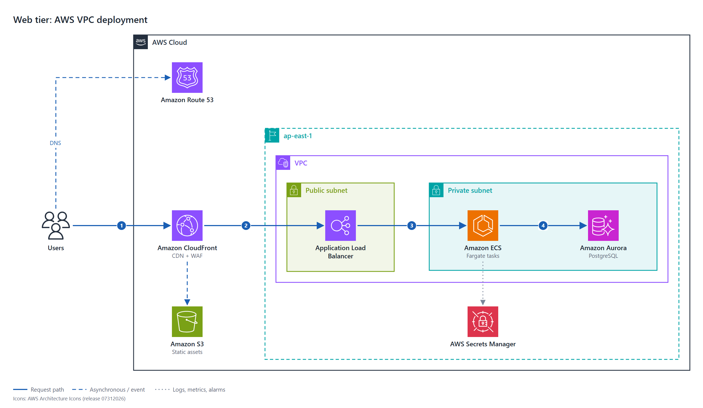

# tech-design-doc

An agent skill that writes technical design documents. It has the agent render and check every diagram before it hands the doc back.

Works with **Claude Code**, **Tencent CodeBuddy**, **GitHub Copilot** and **OpenAI Codex**.



**Why not just ask the AI?**

- **Official vendor icons, not generic boxes.** Cloud diagrams use the icon packs from AWS, Microsoft and Google Cloud.
- **One spec, four outputs.** One JSON spec gives an SVG, a PNG, an editable draw.io file and a Mermaid version.
- **A render check.** The skill tells the agent to render every diagram in headless Chrome, fix overlaps and cramped labels, and re-run the check until it prints `0 FAIL`.
- **A fixed outline.** The doc leads with the decision and follows one of eight outlines from the guide.

**See a finished doc:** [`examples/design-doc/checkout-queue.md`](skills/tech-design-doc/examples/design-doc/checkout-queue.md), a feature change with four Mermaid diagrams and an AWS deployment diagram.

**Guide:** [How to write a design doc](https://whitewhiteqq.github.io/tech-design-doc/) — eight doc outlines, and a preview of the right diagram for each section ([diagram catalogue](https://whitewhiteqq.github.io/tech-design-doc/diagram-types.html)), and [how the skill applies it](https://whitewhiteqq.github.io/tech-design-doc/skill.html).

## What it does

Ask your agent for a design doc, an architecture diagram or a cloud deployment diagram. The skill:

- **Writes the doc in Markdown** (Confluence-ready), as an **HTML** page, or both. The doc leads with the decision.
- **Picks one diagram type per question**: system context, sequence, state, data model, deployment.
- **Draws cloud deployment diagrams with the official vendor icons** for AWS, Azure, Microsoft Entra, Power Platform and Google Cloud. One JSON spec gives SVG, PNG, an editable draw.io file, a Mermaid twin and the Markdown snippet.
- **Checks every diagram in headless Chrome** for overlaps, cramped labels and cut-off marks. The skill has the agent re-run the check until it prints `0 FAIL`.

## Requirements

| Tool | Needed for |
|---|---|
| Python 3.10+ (standard library only) | every script |
| Chrome, Chromium or Edge | the diagram check and the PNG output (set `CHROME=<path>` if the scripts cannot find it) |
| Node.js | the HTML kit and its screenshots |
| `pymupdf` (optional) | PDF output only |

## Install

### Option 1: Claude Code plugin

```bash
claude plugin marketplace add whitewhiteqq/tech-design-doc
claude plugin install tech-design-doc@tech-design-doc
```

### Option 2: Tencent CodeBuddy plugin

```bash
codebuddy plugin marketplace add whitewhiteqq/tech-design-doc
codebuddy plugin install tech-design-doc@tech-design-doc
```

Inside a CodeBuddy session, the same commands work as `/plugin marketplace add whitewhiteqq/tech-design-doc` and `/plugin install tech-design-doc@tech-design-doc`.

### Option 3: `npx skills add`

```bash
npx skills add whitewhiteqq/tech-design-doc                 # into the current project, every detected agent
npx skills add whitewhiteqq/tech-design-doc -g              # globally
npx skills add whitewhiteqq/tech-design-doc -a codebuddy    # CodeBuddy only (.codebuddy/skills/)
```

### Option 4: Manual copy

```bash
git clone https://github.com/whitewhiteqq/tech-design-doc.git
```

Windows PowerShell (use `$HOME`, not `~`, as the destination):

```powershell
Copy-Item -Recurse tech-design-doc\skills\tech-design-doc $HOME\.claude\skills\      # Claude Code
Copy-Item -Recurse tech-design-doc\skills\tech-design-doc $HOME\.codebuddy\skills\   # Tencent CodeBuddy
Copy-Item -Recurse tech-design-doc\skills\tech-design-doc .github\skills\            # GitHub Copilot
```

macOS, Linux or Git Bash:

```bash
cp -r tech-design-doc/skills/tech-design-doc ~/.claude/skills/      # Claude Code
cp -r tech-design-doc/skills/tech-design-doc ~/.codebuddy/skills/   # Tencent CodeBuddy
cp -r tech-design-doc/skills/tech-design-doc .github/skills/        # GitHub Copilot
```

## Add the cloud icon packs (one time)

The repository does not ship the vendor icon packs. Their terms permit the icons in diagrams, not redistribution.

1. Create the icon folder. It works for every install method and survives plugin updates.

   Windows PowerShell:
   ```powershell
   New-Item -ItemType Directory -Force "$HOME\.tech-design-doc\icons"
   ```
   macOS, Linux or Git Bash:
   ```bash
   mkdir -p ~/.tech-design-doc/icons
   ```
2. Download each pack you need. Save it in that folder under this file name:

   | File name | Download |
   |---|---|
   | `aws-icons.zip` | [AWS Architecture Icons](https://aws.amazon.com/architecture/icons/) ("Icon package") |
   | `azure-icons.zip` | [Azure Public Service Icons](https://arch-center.azureedge.net/icons/Azure_Public_Service_Icons_V24.zip) |
   | `entra-icons.zip` | [Microsoft Entra architecture icons](https://learn.microsoft.com/en-us/entra/architecture/architecture-icons) |
   | `power-platform-icons.zip` | [Microsoft Power Platform icons](https://learn.microsoft.com/en-us/power-platform/guidance/icons) |
   | `gcp-core-icons.zip` | [Google Cloud core product icons](https://services.google.com/fh/files/misc/core-products-icons.zip) |
   | `gcp-category-icons.zip` | [Google Cloud product category icons](https://services.google.com/fh/files/misc/category-icons.zip) |

3. Build the icon index. It runs once, after the packs are in place. Run the `icons.py` of the
   installed skill. Where that is depends on how you installed:

   | Installed with | The script sits at |
   |---|---|
   | Option 3, `npx skills add -g` | `~/.claude/skills/tech-design-doc/scripts/icons.py` |
   | Option 4, manual copy | the folder you copied to, for example `~/.claude/skills/tech-design-doc/scripts/icons.py` |
   | Option 1, Claude Code plugin | `~/.claude/plugins/cache/tech-design-doc/tech-design-doc/<version>/skills/tech-design-doc/scripts/icons.py` |
   | Option 2, CodeBuddy plugin | `~/.codebuddy/plugins/cache/tech-design-doc/tech-design-doc/<version>/skills/tech-design-doc/scripts/icons.py` |

   Example, Windows PowerShell with `npx skills add -g`:

   ```powershell
   python $HOME\.claude\skills\tech-design-doc\scripts\icons.py rebuild
   ```

   Example, macOS or Linux with the same install:

   ```bash
   python ~/.claude/skills/tech-design-doc/scripts/icons.py rebuild
   ```

   The command prints the number of icons it found, such as `1554 icons indexed`. The cache lives
   next to the packs, so the packs folder must stay writable.

To keep the packs somewhere else, set the environment variable `TECH_DESIGN_DOC_ICONS` to that folder. The scripts use the first of these folders that holds a pack:

1. `TECH_DESIGN_DOC_ICONS`
2. `~/.tech-design-doc/icons/`
3. the skill's own `vendor-icons/` folder

Do not save packs inside an installed plugin: a plugin update replaces that folder.

Without packs, everything works except cloud deployment diagrams and the `services` figure of the HTML kit. When a pack is missing, the scripts print the folders they searched and the download links. The terms of each pack are in [`vendor-icons/README.md`](skills/tech-design-doc/vendor-icons/README.md).

## Use

Ask the agent in plain words:

```text
Write a design doc for moving our order service to SQS, Markdown for Confluence.
Draw the AWS deployment diagram for this repo.
Rewrite docs/payments.md as a design doc and add an HTML version.
```

The skill asks one question when the output format is unclear: Markdown, HTML or both.

## Examples

- [`examples/design-doc/checkout-queue.md`](skills/tech-design-doc/examples/design-doc/checkout-queue.md): a finished Markdown design doc (feature change), with its deployment diagram in `img/`.
- [`examples/deployment/`](skills/tech-design-doc/examples/deployment/): four deployment diagrams (AWS VPC web app, AWS distributed transaction, Azure web app, Google Cloud event pipeline), each with its JSON spec.
- [`examples/relay-design.html`](skills/tech-design-doc/examples/relay-design.html): a finished HTML design page.

## Repository layout

```
tech-design-doc/
├── .claude-plugin/              # Plugin and marketplace manifests (Claude Code; CodeBuddy reads plugin.json here)
├── .codebuddy-plugin/           # Marketplace manifest for CodeBuddy (a copy of .claude-plugin/marketplace.json)
├── docs/                        # The GitHub Pages guide: doc outlines, diagram catalogue, skill page
└── skills/tech-design-doc/
    ├── SKILL.md                 # The skill: what the agent reads first
    ├── reference/               # Doc skeletons, diagram types, cloud diagram spec, fixes
    ├── scripts/                 # icons.py, cloud_diagram.py, check_diagrams.py
    ├── kit/                     # HTML page kit: shells, figure templates, build.py
    ├── examples/                # A finished Markdown doc, finished diagrams, a finished HTML page
    ├── vendor-icons/            # README with download links and terms; the zips stay local
    └── vendor-js/               # Mermaid browser bundle (MIT) for the offline check
```

## Contributing

See [CONTRIBUTING.md](CONTRIBUTING.md).

## License

Apache-2.0. See [LICENSE](LICENSE).

Third-party content:

- `vendor-js/mermaid.min.js`: Mermaid, MIT licence ([`MERMAID-LICENSE.txt`](skills/tech-design-doc/vendor-js/MERMAID-LICENSE.txt)).
- The example diagrams contain AWS, Microsoft and Google Cloud icons, used under each vendor's terms for architecture diagrams. Those icons are not under Apache-2.0. Each diagram carries the vendor's credit line. See [`vendor-icons/README.md`](skills/tech-design-doc/vendor-icons/README.md) for the exact terms.
- AWS, Azure, Microsoft Entra, Power Platform and Google Cloud are trademarks of their owners. This project has no affiliation with them.
