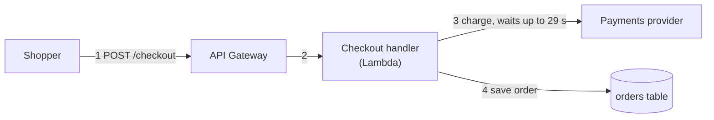
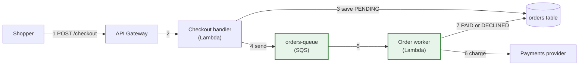
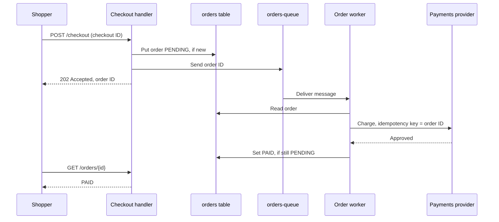
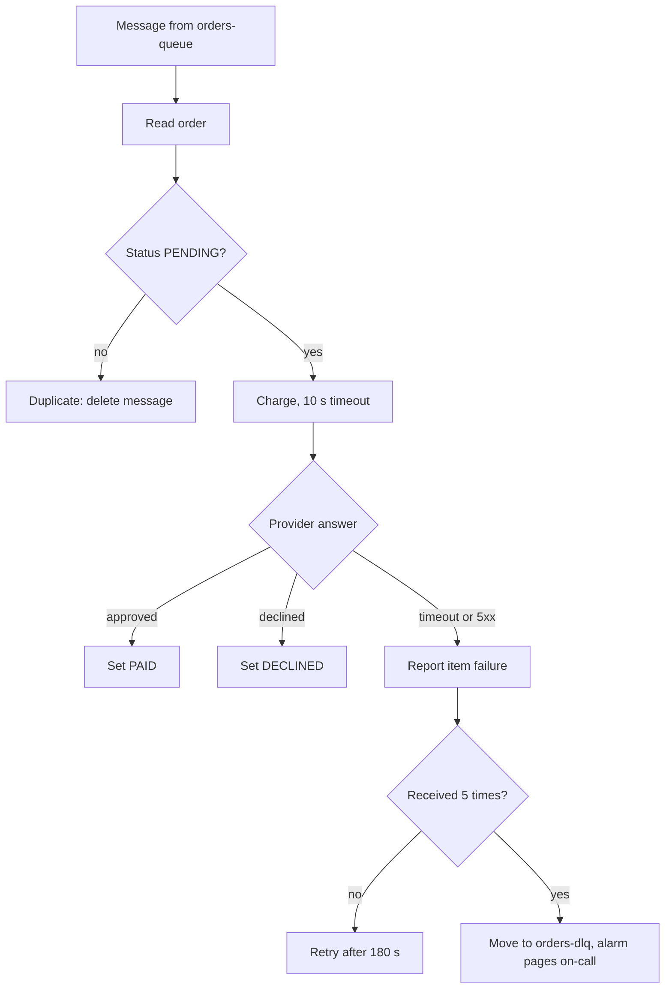
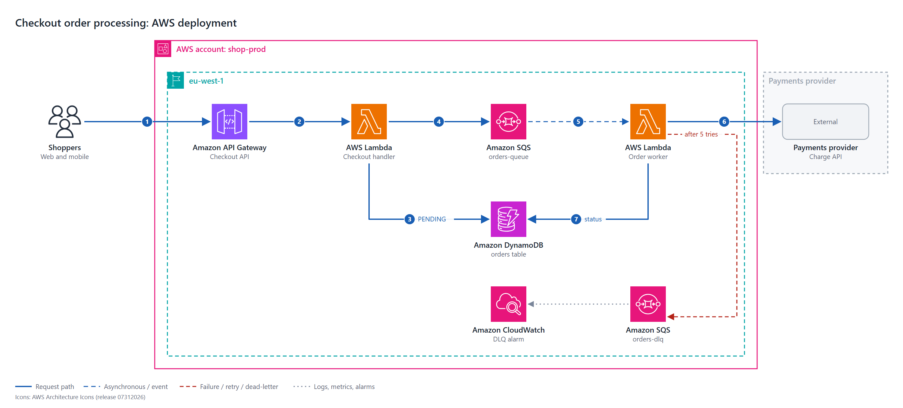

# Checkout order processing

| Status | Owner | Reviewers | Updated |
|---|---|---|---|
| Proposed | Orders team | Payments team, on-call lead | 2026-10-09 |

## What changes

Checkout stops calling the Payments provider inside the shopper's request. The Checkout handler
saves the order as `PENDING`, puts a message on an SQS queue, and returns `202 Accepted` at once.
A worker Lambda reads the queue, charges the card, and sets the order to `PAID` or `DECLINED`.
When the provider slows down, messages wait in the queue; checkout stays fast and no order is lost.

Today a provider slowdown takes checkout down with it. On the last two slow days, calls took
20 to 40 seconds. Every handler sat waiting, API Gateway cut requests at 29 seconds, and
shoppers saw errors on orders the provider later charged.

Rejected:

- **Longer timeouts and more Lambda concurrency:** slow calls then hold more capacity, and API
  Gateway still cuts every request at 29 seconds.
- **A Step Functions workflow:** it adds a second state store next to the orders table, for a flow
  with one external call.

## Today

The question: what in checkout waits on the Payments provider?

The shopper's request holds a Lambda instance for the whole provider call. A slow provider fills
the Lambda concurrency, and new checkouts fail too.

## After

Same picture, changes in green: the queue and the worker sit between checkout and the provider.

The Checkout handler no longer calls the provider. It returns `202` with the order ID, and the
order page polls `GET /orders/{id}` until the status changes.

## New flow

The question: in what order do the messages go for one checkout?

The shopper's browser makes the checkout ID once and sends it again on a retry. So a double click
or a retry never makes a second order.

## Failure handling

The question: what does the worker check, and where does it branch?

- The idempotency key is the order ID. A retry after a timeout cannot charge the card twice.
- The worker's event source mapping caps concurrency at 20. A slow provider gets 20 calls at a time,
  not a flood of retries.
- The visibility timeout (180 s) is six times the worker timeout (30 s), as AWS recommends.
- A message in `orders-dlq` keeps its order `PENDING`. On-call re-drives it after the provider
  recovers.

## Data changes

| Item | Change | Old readers |
|---|---|---|
| `orders.status` | New values `PENDING` and `DECLINED`; `PAID` stays | The order page and the email job read `PAID` only. No change. |
| `orders.checkout_id` | New field, the key for the "if new" put | None |
| `orders.paid_at` | Set by the worker, not the handler | Finance export reads it. Same format. |

No backfill: every existing order is already `PAID`.

## Cloud deployment

Editable source: [deploy.drawio](img/deploy.drawio) (attach it to the Confluence page and open it with the draw.io macro).

*Icons: AWS Architecture Icons (release 07312026).*

## Risk and rollback

| Risk | Control |
|---|---|
| The handler saves the order but the send fails | The handler returns `503`. The shopper's retry finds the `PENDING` order and sends again. |
| Orders stay `PENDING` for a long time | An alarm fires when the oldest message is older than 5 minutes. |
| Shoppers wait on a spinner during a slowdown | The order page shows "Payment in progress" and sends an email when the status changes. |

Rollback: the flag `checkout.async` switches the handler back to the direct call in under a minute.
The worker keeps draining the queue, so no queued order is lost. No step is one-way.

## Tests

1. Load test with a fake provider that answers in 40 s: checkout `p99` stays under 1 s, and no
   order is lost.
2. Send the same message twice: the provider gets one charge.
3. Fake provider returns `500` five times: the message lands in `orders-dlq`, and the alarm fires.
4. Turn `checkout.async` off during a load test: checkout falls back with no failed order.
